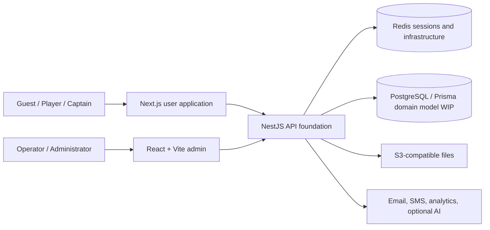

# Groundborn Engineering Showcase

> A portfolio-safe engineering journal for an esports tournament platform currently under active development.

[Русская версия](README.ru.md)

[](docs/status.md)
[](https://www.typescriptlang.org/)
[](https://nextjs.org/)
[](https://react.dev/)
[](https://nestjs.com/)
[](https://github.com/RaysAndreyRU/groundborn-showcase/actions/workflows/quality.yml)

## Why this repository exists

Groundborn is being built as a platform for esports tournaments, teams, players, registrations, matches, brackets, schedules, ratings, and operational administration.

The product is not presented as finished. The private repositories currently contain a strong technical foundation, working application shells, selected administrative screens, authentication and infrastructure components, and domain API scaffolds. Core tournament business flows and persistence are still being implemented.

This repository makes the current engineering direction reviewable without publishing private source code. It contains:

- an honest implemented / in-progress / planned status map;
- system and role-oriented architecture diagrams;
- case studies based on the existing foundation;
- executable design prototypes for tournament lifecycle and bracket seeding;
- documented decisions, limitations, testing strategy, and roadmap boundaries;
- no credentials, private environment files, production schemas, or copied application source.

## Product direction

Groundborn is designed around four main audiences:

- guests explore tournaments, teams, players, matches, and ratings;
- players manage profiles, teams, invitations, and tournament participation;
- captains manage rosters and tournament applications;
- operators and administrators manage moderation, registrations, schedules, brackets, results, notifications, payments, content, and audit history.

## Current system shape



Both frontends use FSD-oriented layers, React Query, runtime schemas, Orval-ready OpenAPI integration, deterministic MSW infrastructure, and shared design primitives. The backend provides NestJS module composition, authentication utilities, Redis, logging, Swagger, health checks, file and messaging infrastructure. Most tournament domain endpoints currently return explicit `IN DEVELOPMENT` responses and the Prisma domain schema is not yet populated.

Read the [architecture overview](docs/architecture.md) and [current status](docs/status.md).

## Engineering case studies

| Case study | What it demonstrates | Maturity |
| --- | --- | --- |
| [Product foundation before domain completion](docs/case-studies/01-product-foundation.md) | Building observable, testable delivery foundations without claiming finished features. | Implemented foundation |
| [Two FSD-oriented frontend surfaces](docs/case-studies/02-dual-frontend-boundaries.md) | Separate user and operator experiences with shared architectural rules. | Implemented foundation |
| [Contract-first mock development](docs/case-studies/03-contract-first-mocks.md) | Seeded MSW state, Zod boundaries, React Query, and Orval-ready API migration. | Partially implemented |
| [Authentication recovery and route access](docs/case-studies/04-auth-and-route-access.md) | Single-flight refresh, SSR checks, middleware routing, JWT and Redis infrastructure. | Partially implemented |
| [Modular backend scaffold](docs/case-studies/05-backend-foundation.md) | Domain module boundaries, Swagger groups, infrastructure composition, and test scaffolds. | Implemented scaffold |
| [Observability and quality gates](docs/case-studies/06-observability-and-quality.md) | Sentry, web vitals, Pino, health checks, lint, typecheck, build, and backend tests. | Implemented foundation |
| [Tournament domain roadmap](docs/case-studies/07-tournament-domain-roadmap.md) | Lifecycle, registration, scheduling, bracket, idempotency, and persistence decisions. | Design / planned |

## Executable design prototypes

The public sample contains two pure TypeScript prototypes:

```text
src/
├── tournament-lifecycle/
│   ├── application/transition-tournament.ts
│   └── domain/tournament-lifecycle.types.ts
└── bracket-planner/
    ├── application/plan-first-round.ts
    └── domain/bracket.types.ts
```

### Tournament lifecycle

- explicit states from `DRAFT` to `ARCHIVED`;
- guarded transitions instead of arbitrary status updates;
- cancellation paths;
- auditable transition output;
- domain-specific errors for invalid operations.

### Single-elimination bracket planner

- deterministic standard seed placement;
- bracket sizing to the next power of two;
- automatic BYEs for the highest seeds;
- stable match identifiers and positions;
- validation of duplicate IDs and invalid seeds;
- no network, database, or framework dependency.

These prototypes are executable design work derived from the current product requirements. They are not copied from the private backend and should not be interpreted as already deployed product behavior.

## Run the prototypes

Requirements: Node.js 22 and npm.

```bash
npm ci
npm run check
```

| Command | Purpose |
| --- | --- |
| `npm test` | Run behavior tests with Vitest. |
| `npm run test:coverage` | Run tests and enforce coverage thresholds. |
| `npm run typecheck` | Validate strict TypeScript contracts. |
| `npm run check` | Run the complete local quality gate. |

## Technology map

| Surface | Technologies |
| --- | --- |
| User application | Next.js 15, React 19, TypeScript, React Query, Zustand, Zod, MSW, i18next, Sentry |
| Admin application | React 19, Vite 6, React Router 7, React Query, Zustand, Zod, MSW, i18next |
| Backend foundation | NestJS, Prisma, PostgreSQL, Redis, JWT, Swagger, Pino, S3-compatible storage |
| Delivery | Docker, Vercel configuration, GitHub Actions, Husky, Commitlint |
| Public prototypes | TypeScript, Vitest |

## Disclosure boundary

This showcase deliberately excludes private source files, environment configuration, infrastructure credentials, database migrations, exact API contracts, and provider configuration. Product requirements are summarized at a system-design level and are not a promise that every described capability is already available.

## Author

**Andrey Rays** — Senior Fullstack Developer & Web3 Engineer

- GitHub: [@RaysAndreyRU](https://github.com/RaysAndreyRU)
- Telegram: [@RaysRU](https://t.me/RaysRU)
- Email: [raysandreyru@gmail.com](mailto:raysandreyru@gmail.com)

## Usage notice

This repository is published for portfolio review and technical evaluation. See [LICENSE](LICENSE) for usage restrictions.
