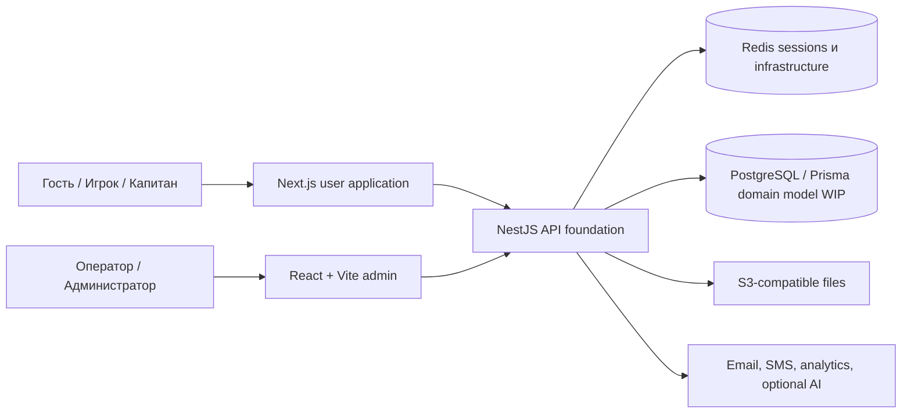

# Groundborn — инженерная витрина

> Безопасный для публичного портфолио инженерный журнал киберспортивной турнирной платформы, которая находится в активной разработке.

[English version](README.md)

[](docs/status.md)
[](https://www.typescriptlang.org/)
[](https://nextjs.org/)
[](https://react.dev/)
[](https://nestjs.com/)
[](https://github.com/RaysAndreyRU/groundborn-showcase/actions/workflows/quality.yml)

## Зачем нужен этот репозиторий

Groundborn разрабатывается как платформа для киберспортивных турниров, команд, игроков, заявок, матчей, сеток, расписаний, рейтингов и административного управления.

Проект не выдаётся за завершённый. В приватных репозиториях уже есть серьёзная техническая основа, работающие application shells, отдельные административные экраны, auth- и infrastructure-компоненты и каркас доменного API. Основные турнирные бизнес-сценарии и persistence-слой ещё разрабатываются.

Этот репозиторий позволяет оценить текущее инженерное направление без публикации приватного кода. Здесь находятся:

- честная карта `реализовано / в разработке / запланировано`;
- системные и ролевые диаграммы;
- case studies существующей технической основы;
- запускаемые design prototypes жизненного цикла турнира и турнирной сетки;
- решения, ограничения, testing strategy и границы roadmap;
- никаких секретов, приватных env-файлов, production-схем или скопированного исходного кода.

## Направление продукта

- Гости просматривают турниры, команды, игроков, матчи и рейтинги.
- Игроки управляют профилями, командами, приглашениями и участием в турнирах.
- Капитаны управляют составами и турнирными заявками.
- Операторы и администраторы управляют модерацией, заявками, расписанием, сетками, результатами, уведомлениями, платежами, контентом и аудитом.

## Текущая форма системы



Оба frontend используют FSD-oriented слои, React Query, runtime-схемы, Orval-ready OpenAPI integration, детерминированный MSW и общие UI primitives. Backend содержит NestJS module composition, auth infrastructure, Redis, logging, Swagger, health checks, файлы и messaging. Большинство турнирных endpoint сейчас явно возвращают `IN DEVELOPMENT`, а доменная Prisma-схема ещё не наполнена.

Подробнее: [архитектура](docs/architecture.md) и [текущий статус](docs/status.md).

## Инженерные case studies

1. [Технический фундамент до завершения домена](docs/case-studies/01-product-foundation.ru.md).
2. [Два FSD-oriented frontend-контура](docs/case-studies/02-dual-frontend-boundaries.ru.md).
3. [Contract-first разработка с MSW](docs/case-studies/03-contract-first-mocks.ru.md).
4. [Auth recovery и контроль маршрутов](docs/case-studies/04-auth-and-route-access.ru.md).
5. [Модульный backend scaffold](docs/case-studies/05-backend-foundation.ru.md).
6. [Observability и quality gates](docs/case-studies/06-observability-and-quality.ru.md).
7. [Roadmap турнирного домена](docs/case-studies/07-tournament-domain-roadmap.ru.md).

## Запускаемые design prototypes

### Жизненный цикл турнира

- явные статусы от `DRAFT` до `ARCHIVED`;
- проверяемые переходы вместо произвольного обновления статуса;
- cancellation paths;
- результат перехода, пригодный для аудита;
- доменная ошибка для запрещённых операций.

### Single-elimination bracket planner

- детерминированное размещение seed;
- размер сетки как следующая степень двойки;
- автоматические BYE для лучших seed;
- стабильные идентификаторы и позиции матчей;
- проверка повторяющихся ID и некорректного посева;
- отсутствие зависимости от framework, сети и базы данных.

Это исполняемые design prototypes на основе текущих продуктовых требований. Они не скопированы из приватного backend и не означают, что такое поведение уже развёрнуто в продукте.

## Запуск

Нужны Node.js 22 и npm.

```bash
npm ci
npm run check
```

## Текущий инженерный статус

| Область | Состояние |
| --- | --- |
| Frontend shells, routing, providers, design system | Реализован foundation |
| Auth UI, API clients, mock infrastructure | Частично реализовано |
| Admin notifications, logs, payments and dashboard views | Активная разработка |
| Backend infrastructure, Swagger, Redis, logging, files | Реализован foundation |
| Tournament CRUD and business services | Scaffold / `IN DEVELOPMENT` |
| Prisma tournament data model | Запланировано |
| Сквозные tournament workflows | Запланировано |

## Автор

**Andrey Rays** — Senior Fullstack Developer & Web3 Engineer

- GitHub: [@RaysAndreyRU](https://github.com/RaysAndreyRU)
- Telegram: [@RaysRU](https://t.me/RaysRU)
- Email: [raysandreyru@gmail.com](mailto:raysandreyru@gmail.com)

## Условия использования

Репозиторий опубликован для просмотра портфолио и технической оценки. Ограничения описаны в [LICENSE](LICENSE).
