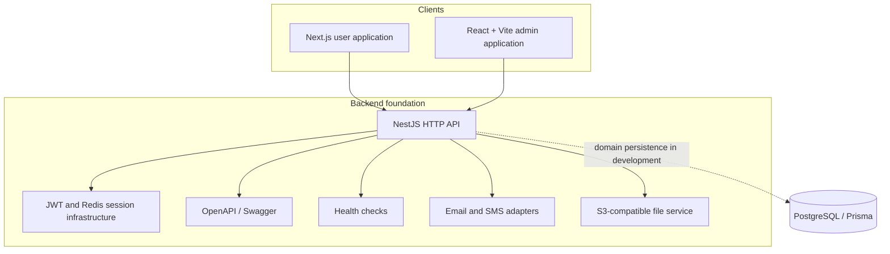
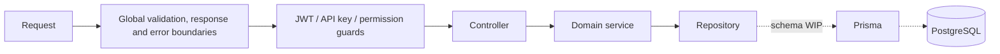
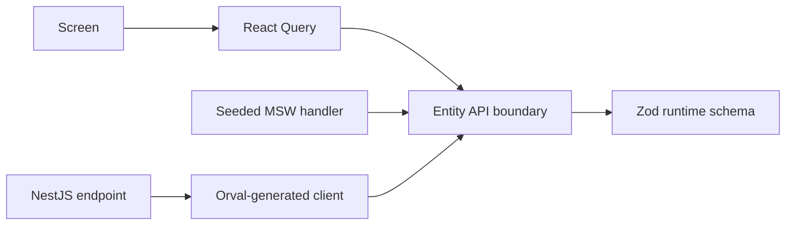

# Architecture Overview

## Runtime surfaces



The solid connections represent infrastructure already present in the private repositories. The dotted persistence connection marks the intended boundary whose tournament data model is still under development.

## Frontend boundaries

Both frontend repositories use the same directional vocabulary:

```text
app → pages → widgets → features → entities → shared
```

- `app` composes providers, routing, layouts, and initialization;
- `pages` provide thin route entry points;
- `widgets` assemble page-scale interface blocks;
- `features` model user actions and scenarios;
- `entities` own domain schemas, API access, and reusable domain UI;
- `shared` contains cross-domain infrastructure and design primitives.

The user application uses Next.js Pages Router, SSR helpers, middleware, SEO generation, and Sentry instrumentation. The admin application uses React Router lazy routes, a Vite runtime, operational layouts, and selected dashboard, notification, payment, and log views.

## Backend request shape



The controller/service/repository modules exist for users, tournaments, teams, players, registrations, matches, brackets, and schedules, including parallel admin surfaces. At the current stage, these modules are structural scaffolds: most controllers return `IN DEVELOPMENT`, services are empty, and repositories point at not-yet-defined Prisma models.

## Contract migration path



The intended migration path keeps screen composition stable while replacing deterministic mock adapters with generated API clients as backend contracts become real.
