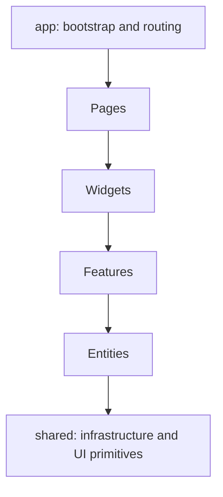

# Case Study: Two FSD-oriented Frontend Surfaces

**Maturity:** implemented foundation.

## Decision

Groundborn separates public/player workflows from dense operator workflows:

- Next.js provides SSR, middleware, SEO, sitemap generation, and public routes;
- React with Vite provides lazy-loaded administrative routes and an operator-focused layout.

Both use the same downward dependency vocabulary:

```text
app → pages → widgets → features → entities → shared
```



## Why two applications

Public discovery and player participation benefit from server rendering and SEO. Administrative tables, logs, notifications, payments, and moderation prioritize authenticated interaction and operational density. Sharing architectural rules reduces cognitive switching without forcing identical runtimes.

## Trade-offs

- schemas and UI primitives can drift between repositories;
- FSD directories alone do not guarantee completed domain slices;
- duplicated auth clients need coordinated security hardening;
- a shared package may become useful only after concepts stabilize.
