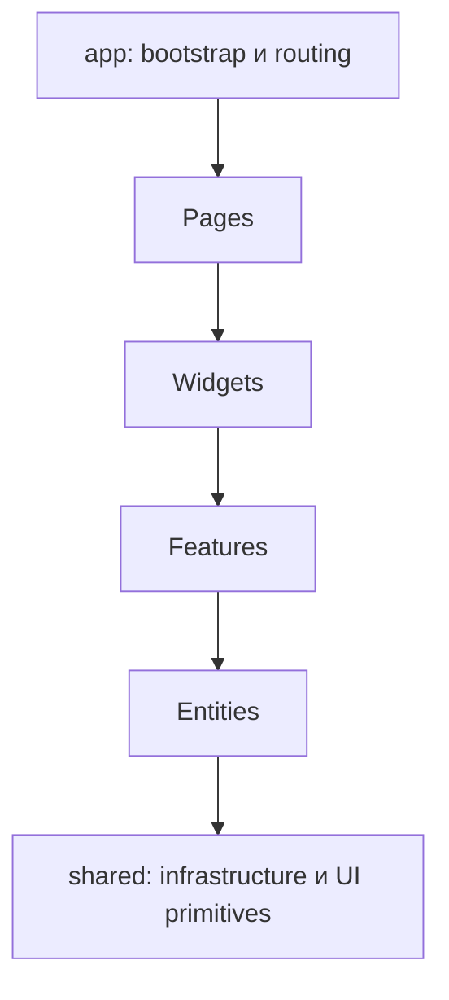

# Кейс: два FSD-oriented frontend-контура

[English](02-dual-frontend-boundaries.md) | [Русский](02-dual-frontend-boundaries.ru.md)

**Зрелость:** реализованный фундамент.

## Решение

Groundborn разделяет публичные/player-сценарии и насыщенные операторские процессы:

- Next.js обеспечивает SSR, middleware, SEO, sitemap generation и публичные маршруты;
- React с Vite обеспечивает lazy-loaded административные маршруты и layout для операторской работы.

Оба приложения используют единый словарь нисходящих зависимостей:

```text
app → pages → widgets → features → entities → shared
```



## Почему два приложения

Публичный поиск и участие игроков выигрывают от server rendering и SEO. Административные таблицы, логи, уведомления, платежи и модерация требуют авторизованного взаимодействия и высокой информационной плотности. Общие архитектурные правила уменьшают переключение контекста, не заставляя приложения использовать одинаковый runtime.

## Компромиссы

- schemas и UI primitives могут расходиться между репозиториями;
- наличие FSD-директорий само по себе не гарантирует завершённость доменных slices;
- дублирующиеся auth clients требуют согласованного security hardening;
- общий package стоит выделять только после стабилизации концепций.
