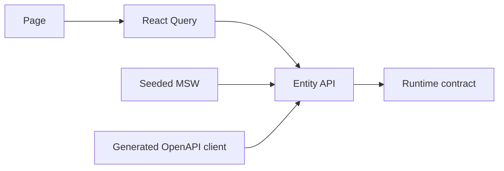

# Case Study: Contract-first Mock Development

**Maturity:** partially implemented.

## Problem

Frontend work started before tournament endpoints and Prisma models were ready. Hardcoded data inside pages would couple UI composition to temporary shapes.

## Approach

Both applications include MSW handlers, seeded mock state, entity schemas, React Query boundaries, and Orval configuration.

The intended migration replaces the adapter rather than the page. Seed configuration makes demonstrations reproducible and strict mock mode can expose unexpected requests.

## Current caveat

Some mock modules still reflect the original project template rather than Groundborn terminology. They are infrastructure evidence, not evidence that those unrelated product capabilities belong to Groundborn. Domain-specific handlers and generated clients remain migration work.

## Engineering signal

The useful design is the replaceable boundary: runtime schemas and query hooks can survive the move from deterministic mocks to live endpoints.
