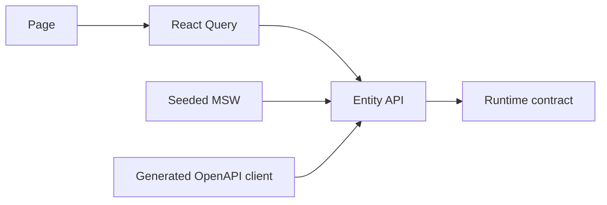

# Кейс: contract-first разработка с mock-данными

[English](03-contract-first-mocks.md) | [Русский](03-contract-first-mocks.ru.md)

**Зрелость:** частично реализовано.

## Проблема

Frontend-разработка началась до готовности турнирных endpoint и Prisma-моделей. Hardcoded-данные внутри страниц связали бы UI-композицию с временными структурами.

## Подход

Оба приложения содержат MSW handlers, seeded mock state, entity schemas, границы React Query и конфигурацию Orval.

При миграции заменяется adapter, а не page. Seed-конфигурация делает демонстрации воспроизводимыми, а строгий mock-режим обнаруживает неожиданные запросы.

## Текущее ограничение

Некоторые mock-модули всё ещё отражают исходный шаблон проекта, а не терминологию Groundborn. Они подтверждают наличие инфраструктуры, но не принадлежность несвязанных возможностей продукту. Domain-specific handlers и generated clients остаются частью миграции.

## Инженерный результат

Ценность решения — в заменяемой границе: runtime schemas и query hooks сохраняются при переходе от детерминированных mocks к живым endpoint.
