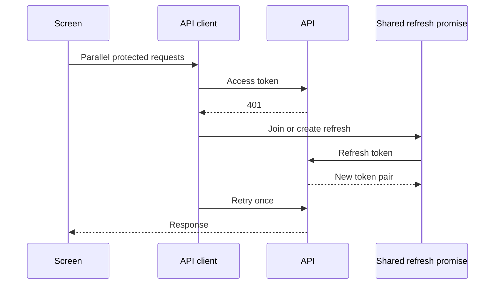

# Case Study: Authentication Recovery and Route Access

[English](04-auth-and-route-access.md) | [Русский](04-auth-and-route-access.ru.md)

**Maturity:** partially implemented.

## Existing client behavior

- browser requests attach the access token;
- concurrent `401` responses join one shared refresh promise;
- the original request retries only once;
- unrecoverable sessions clear local auth state and deduplicate redirect behavior;
- Next.js SSR helpers and middleware redirect unauthenticated routes;
- route maps choose access by role.

## Existing backend foundation

The backend contains JWT access, refresh, and temporary-token services, Redis-related session infrastructure, Passport strategies, API-key and permission guards, and common auth exceptions.

## Hardening boundary

Route checks are user-experience controls, not authorization. Domain ownership and tournament permissions still need backend enforcement. Browser token storage and cookie synchronization require further security review before handling sensitive production workflows.
