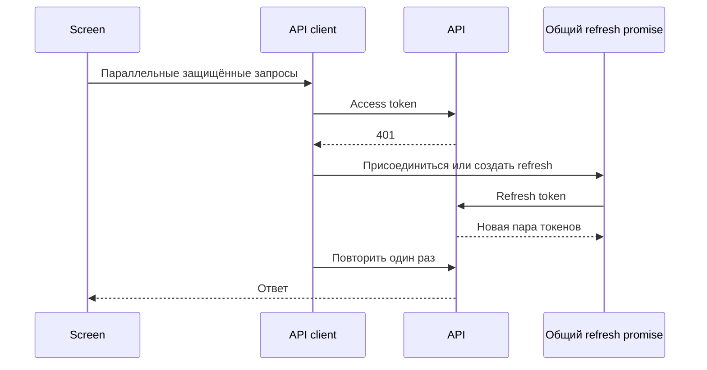

# Кейс: восстановление аутентификации и доступ к маршрутам

[English](04-auth-and-route-access.md) | [Русский](04-auth-and-route-access.ru.md)

**Зрелость:** частично реализовано.

## Существующее поведение клиента

- browser-запросы добавляют access token;
- параллельные ответы `401` присоединяются к одному общему refresh promise;
- исходный запрос повторяется только один раз;
- невосстанавливаемая сессия очищает локальное auth state и дедуплицирует redirect;
- SSR helpers и middleware Next.js перенаправляют неавторизованные маршруты;
- route maps выбирают доступ по роли.

## Существующий backend-фундамент

Backend содержит JWT access-, refresh- и temporary-token services, инфраструктуру Redis sessions, Passport strategies, API-key и permission guards, а также общие auth exceptions.

## Граница hardening

Проверки маршрутов улучшают UX, но не являются авторизацией. Domain ownership и турнирные permissions всё равно должны контролироваться backend. Хранение browser token и синхронизация cookie требуют дополнительного security review до работы с чувствительными production-сценариями.
