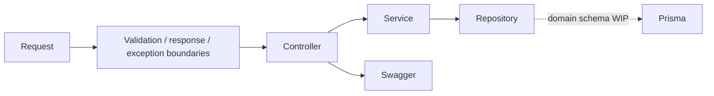

# Case Study: Modular Backend Foundation

[English](05-backend-foundation.md) | [Русский](05-backend-foundation.ru.md)

**Maturity:** implemented infrastructure and domain scaffold.

## Module map

The NestJS application registers public and admin surfaces for users, tournaments, teams, players, registrations, matches, brackets, and schedules. Cross-cutting modules provide configuration, Redis, Prisma, Pino, events, scheduling, HTTP clients, auth, files, messaging, health, i18n, analytics, and optional AI integration.

## What the tests currently prove

- module definitions and providers can be assembled;
- infrastructure factories receive expected configuration;
- Swagger exposes intended API groups;
- the common repository contract can be exercised with doubles;
- every scaffolded resource follows the same structural module shape.

## What they do not prove yet

- tournament business rules;
- database-backed CRUD behavior for esports entities;
- authorization ownership invariants;
- bracket progression or concurrency safety;
- complete end-to-end workflows.

## Engineering signal

The scaffold gives domain teams predictable extension points, but its uniformity is treated as preparation rather than completed business logic.
