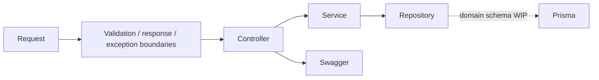

# Кейс: модульный backend-фундамент

[English](05-backend-foundation.md) | [Русский](05-backend-foundation.ru.md)

**Зрелость:** реализованная инфраструктура и доменный scaffold.

## Карта модулей

NestJS-приложение регистрирует публичные и административные контуры пользователей, турниров, команд, игроков, заявок, матчей, сеток и расписаний. Сквозные модули предоставляют configuration, Redis, Prisma, Pino, events, scheduling, HTTP clients, auth, files, messaging, health, i18n, analytics и optional AI integration.

## Что доказывают текущие тесты

- определения модулей и providers можно собрать вместе;
- infrastructure factories получают ожидаемую конфигурацию;
- Swagger публикует запланированные API groups;
- общий repository contract проверяется с doubles;
- каждый scaffolded resource следует единой структурной форме модуля.

## Чего они пока не доказывают

- турнирные бизнес-правила;
- CRUD с базой данных для esports-сущностей;
- authorization ownership invariants;
- продвижение по сетке и concurrency safety;
- полные end-to-end процессы.

## Инженерный результат

Scaffold даёт доменным командам предсказуемые extension points, но его единообразие рассматривается как подготовка, а не как завершённая бизнес-логика.
