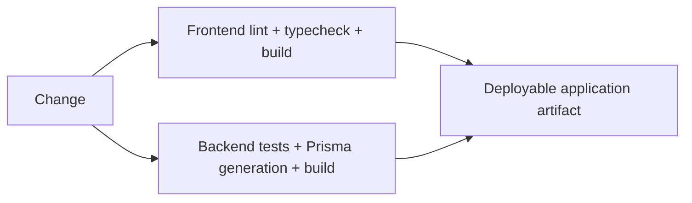

# Case Study: Observability and Quality Gates

[English](06-observability-and-quality.md) | [Русский](06-observability-and-quality.ru.md)

**Maturity:** implemented foundation.

## Frontend signals

The user application includes Sentry registration for client and server runtimes, router transition instrumentation, web-vitals reporting, development render diagnostics, SEO generation, and bundle/dependency analysis commands.

## Backend signals

The backend configures environment-aware Pino logging, normalized exception output, health checks, Redis readiness visibility, Swagger generation, and unit coverage in CI.

## Delivery gates

## Current limitation

The user app has only a narrow source-level test, and the admin app has no configured behavior-test runner. Backend tests are much broader but many validate resource scaffolding. Quality commands are real; business coverage is still a development target.
