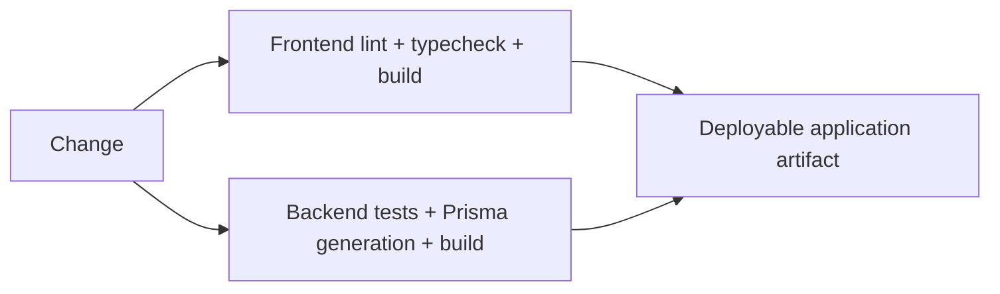

# Кейс: observability и quality gates

[English](06-observability-and-quality.md) | [Русский](06-observability-and-quality.ru.md)

**Зрелость:** реализованный фундамент.

## Frontend-сигналы

Пользовательское приложение содержит регистрацию Sentry для client- и server-runtime, инструментацию переходов router, отчёты web vitals, диагностику rendering в development, генерацию SEO и команды анализа bundle/dependencies.

## Backend-сигналы

Backend настраивает environment-aware Pino logging, нормализованные exception responses, health checks, видимость готовности Redis, генерацию Swagger и unit coverage в CI.

## Delivery gates

## Текущее ограничение

В пользовательском приложении есть лишь узкий source-level тест, а в admin ещё не настроен behavior-test runner. Backend-тесты существенно шире, но многие проверяют scaffold ресурсов. Quality-команды реальны; покрытие бизнес-поведения остаётся целью разработки.
