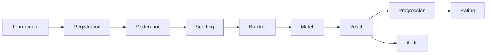

# Case Study: Tournament Domain Roadmap

**Maturity:** design / planned, with executable public prototypes.

## Target aggregate flow

The requirements describe tournament formats, registration windows, team-size rules, moderation statuses, match states, scheduling, single and double elimination, group and Swiss stages, BYEs, ratings, sanctions, payments, and immutable audit history.

## Critical invariants to implement

- a tournament status changes only through allowed transitions;
- a registration cannot exceed capacity or bypass its window;
- a player cannot occupy conflicting roster slots;
- a match result is accepted once, even under retry;
- a winner advances through a bracket node once;
- schedule conflicts are rejected transactionally;
- critical operator actions are authorized and audited.

## Public prototypes

This repository implements two pure design slices:

- a tournament status transition state machine;
- deterministic first-round single-elimination planning with seed placement and BYEs.

They intentionally stop before persistence. The eventual backend application service should combine these pure calculations with transactions, uniqueness constraints, idempotency keys, authorization, and audit records.
