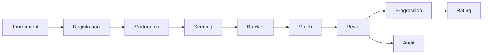

# Кейс: roadmap турнирного домена

[English](07-tournament-domain-roadmap.md) | [Русский](07-tournament-domain-roadmap.ru.md)

**Зрелость:** design / planned с исполняемыми публичными prototypes.

## Целевой aggregate flow

Требования описывают форматы турниров, окна регистрации, правила размера команды, статусы модерации и матчей, расписание, single/double elimination, group и Swiss stages, BYE, рейтинги, санкции, платежи и неизменяемую историю аудита.

## Критические инварианты для реализации

- статус турнира меняется только через разрешённые переходы;
- заявка не может превысить capacity или обойти registration window;
- игрок не может занимать конфликтующие места в составах;
- результат матча принимается один раз даже при retry;
- победитель продвигается через bracket node один раз;
- конфликты расписания отклоняются транзакционно;
- критические действия оператора авторизуются и попадают в аудит.

## Публичные prototypes

Репозиторий реализует два чистых design slice:

- state machine переходов статуса турнира;
- детерминированное планирование первого раунда single-elimination с seed placement и BYE.

Они намеренно заканчиваются до persistence. Будущий backend application service должен объединить эти чистые вычисления с транзакциями, unique constraints, idempotency keys, авторизацией и audit records.
