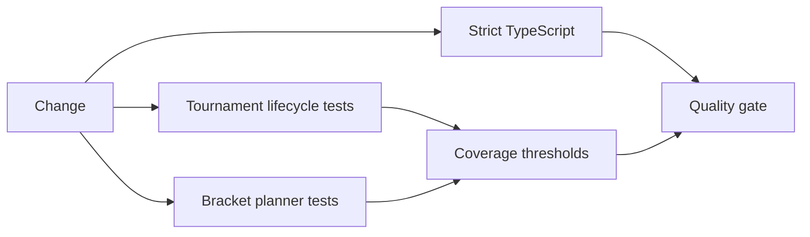

# Testing and Delivery Strategy

## Current private-project checks

| Surface | Existing checks | Current gap |
| --- | --- | --- |
| User app | CI lint, typecheck, Next.js build | One focused source test; no broad behavior suite yet. |
| Admin | CI lint, typecheck, Vite build | No configured application test runner yet. |
| Backend | Jest coverage, module/Swagger/shared tests, Nest build | Many domain tests validate scaffolds rather than business behavior. |
| Docs | Generated product documentation workflow | Requirements still need executable contract traceability. |

## Public prototype checks

The showcase quality gate runs strict TypeScript and behavior tests with coverage thresholds.

The tests verify allowed and forbidden lifecycle transitions, immutable audit output, seed ordering, power-of-two bracket sizing, BYE assignment, and invalid participant input.
