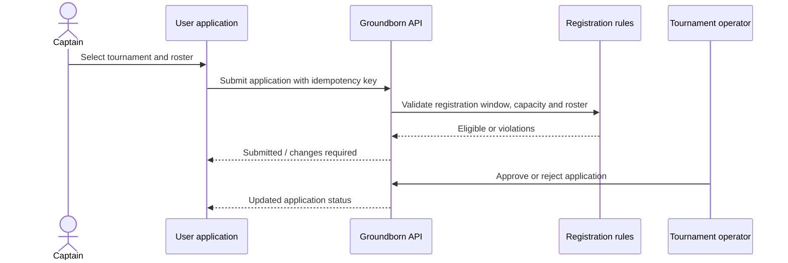

# Target User Flows

These flows describe the current product direction. Their individual steps are not all implemented yet.

## Team tournament registration

## Tournament execution

```mermaid
flowchart LR
    Registration[Close registration] --> Eligible[Freeze eligible participants]
    Eligible --> Seed[Apply deterministic seeding]
    Seed --> Bracket[Generate bracket and matches]
    Bracket --> Schedule[Publish schedule]
    Schedule --> Result[Submit match result]
    Result --> Guard[Idempotency and concurrency guard]
    Guard --> Advance[Advance winner once]
    Advance --> Complete[Complete and archive tournament]
```

## Role boundaries

- guests receive read-only public views;
- players control their own identity and participation;
- captains act only within teams they are allowed to manage;
- tournament operators are scoped to assigned competitions;
- platform administrators require explicit permissions for moderation and configuration;
- critical actions should create immutable audit events.
